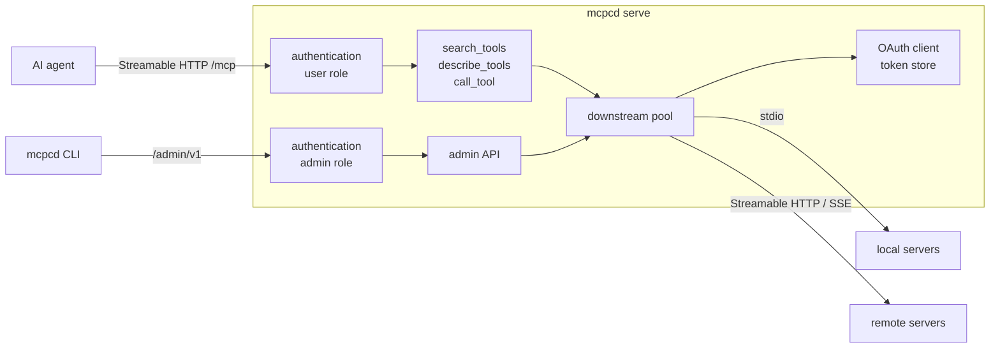

# mcp-compendium

[](https://scorecard.dev/viewer/?uri=github.com/steelshot/mcp-compendium)
[](https://www.bestpractices.dev/projects/16459)
[](https://github.com/steelshot/mcp-compendium/releases/latest)
[](LICENSE.md)

One daemon, `mcpcd`, that serves any number of MCP servers to AI agents as a single Streamable HTTP endpoint. Instead
of registering every downstream tool with the agent, it exposes three tools that let the agent find and call what it
needs:

| Tool             | Purpose                                                                                                            |
|------------------|--------------------------------------------------------------------------------------------------------------------|
| `search_tools`   | Ranked search over every server's tools by intent ("create a GitHub issue"). Its description lists the servers.    |
| `describe_tools` | Full descriptions and input schemas for chosen tools, or every tool of one server as one-line signatures.          |
| `call_tool`      | Call a tool. Arguments are validated first; a mismatch returns the schema so the agent fixes the call in one step. |

Agent clients cap how many tools they accept and pay for every tool definition in context. With a realistic catalogue
of 34 tools, the advertised tool list shrinks by 84 % (see [Measuring agent efficiency](CONTRIBUTING.md#measuring-agent-efficiency)).

It is a single static Go binary: no Node.js, npm or Python at runtime unless a stdio server you add needs them.

## Contents

- [How it works](#how-it-works)
- [Quick start](#quick-start)
- [Configuration](#configuration)
- [Authentication](#authentication)
- [Signing in to OAuth servers](#signing-in-to-oauth-servers)
- [Command line](#command-line)
- [Deployment](#deployment)
- [Contributing](#contributing)
- [Releases](#releases)
- [Migrating from mcp-aggregator](#migrating-from-mcp-aggregator)
- [Licence](#licence)

## How it works



- **Downstream pool.** Connects to every enabled server in parallel at startup and caches its tools. A failed server is
  retried in the background with exponential backoff, and a call to it reconnects on demand. Read-only and idempotent
  tools are retried once after a dropped connection; other tools are not, and the error says the call may have run.
- **Shared or isolated.** One connection serves every agent by default. `isolation: session` gives each agent session
  its own connection, and its own process for stdio servers, so stateful servers such as browsers never mix state.
- **Agent-facing errors** share one JSON shape: `code`, `message`, `hint` (the next action) and context such as
  `suggestions` for misspelt names, `retryAfterSeconds` or `mayHaveRun`.
- **Result shaping.** `structuredContent` that only duplicates a text block is dropped, and text beyond
  `maxResultBytes` (32 KiB by default, roughly 8k tokens) is truncated with a note telling the agent to narrow the
  request. Progress notifications and cancellation pass through.
- **Catalogue updates.** When a server connects, fails or signs in, the `search_tools` description changes and clients
  receive `notifications/tools/list_changed`.

## Quick start

```bash
cat > config.yaml <<'EOF'
servers:
  github:
    type: http
    url: https://api.githubcopilot.com/mcp/
    description: GitHub repositories, issues, pull requests and code search.
    headers:
      Authorization: Bearer ${env:GITHUB_TOKEN}
EOF

export GITHUB_TOKEN=...
mcpcd serve --config config.yaml
```

Point the agent at `http://127.0.0.1:8080/mcp`. For example, in GitHub Copilot CLI's `~/.copilot/mcp-config.json`:

```json
{
	"mcpServers": {
		"compendium": {
			"type": "http",
			"url": "http://127.0.0.1:8080/mcp"
		}
	}
}
```

Binaries for Linux, macOS and Windows are attached to each [release](https://github.com/steelshot/mcp-compendium/releases),
together with a cosign-signed checksum file.

## Configuration

Settings that describe *where* and *how* the daemon runs are flags or environment variables. The servers and inbound
authentication live in a configuration file.

### Environment and flags

Every flag has an environment variable; an explicitly set flag wins over the environment, which wins over the default.

| Variable                           | Flag                  | Default                                                                                                  |
|------------------------------------|-----------------------|----------------------------------------------------------------------------------------------------------|
| `MCP_COMPENDIUM_CONFIG`            | `--config`, `-c`      | `<user config dir>/mcp-compendium`; `/etc/mcp-compendium` in images                                      |
| `MCP_COMPENDIUM_STATE_DIR`         | `--state-dir`         | `$XDG_STATE_HOME/mcp-compendium` or `~/.local/state/mcp-compendium`; `/var/lib/mcp-compendium` in images |
| `MCP_COMPENDIUM_LISTEN`            | `--listen`            | `127.0.0.1:8080`; `:8080` in images                                                                      |
| `MCP_COMPENDIUM_PUBLIC_URL`        | `--public-url`        | unset; the browser-reachable base URL, which enables sign-in links                                       |
| `MCP_COMPENDIUM_LOG_LEVEL`         | `--log-level`         | `info` (`debug`, `info`, `warn`, `error`)                                                                |
| `MCP_COMPENDIUM_LOG_FORMAT`        | `--log-format`        | `json` (`json`, `text`)                                                                                  |
| `MCP_COMPENDIUM_STARTUP_TIMEOUT`   | `--startup-timeout`   | `30s`: connecting to a server and listing its tools                                                      |
| `MCP_COMPENDIUM_EXECUTION_TIMEOUT` | `--execution-timeout` | `1h`: one tool call                                                                                      |
| `MCP_COMPENDIUM_SHUTDOWN_TIMEOUT`  | `--shutdown-timeout`  | `15s`: draining in-flight requests                                                                       |
| `MCP_COMPENDIUM_MAX_RESULT_BYTES`  | `--max-result-bytes`  | `32768`                                                                                                  |

The client commands read `MCP_COMPENDIUM_URL` (default `http://127.0.0.1:8080`) and credentials from
`MCP_COMPENDIUM_TOKEN`, `MCP_COMPENDIUM_TOKEN_FILE`, or `MCP_COMPENDIUM_USERNAME` and `MCP_COMPENDIUM_PASSWORD`.

### Configuration file

`MCP_COMPENDIUM_CONFIG` names a file, or a directory whose `*.yaml`, `*.yml`, `*.json`, `*.jsonc` and `*.toml` files
are merged in name order (hidden files are skipped, so Kubernetes ConfigMap mounts work). A server or auth provider
defined in two files is an error, never a silent override. Every problem in every file is reported at once, with its
file and path:

```text
Error: invalid configuration:
  conf.d/10-github.yaml: servers.github.url: must be an absolute http or https URL
  conf.d/20-files.yaml: servers.files.command: placeholder: environment variable FS_BIN is not set and ${env:FS_BIN} has no :-default
```

All four formats share one [JSON Schema](schema/config.schema.json) (`mcpcd config schema` prints it). Editors pick it
up with `# yaml-language-server: $schema=…` in YAML, `"$schema"` in JSON, or `#:schema …` in TOML.

```yaml
# yaml-language-server: $schema=https://raw.githubusercontent.com/steelshot/mcp-compendium/main/schema/config.schema.json
servers:
  github:
    type: http                     # stdio, http (Streamable HTTP) or sse (the deprecated 2024-11-05 transport)
    url: https://api.githubcopilot.com/mcp/
    description: GitHub repositories, issues, pull requests and code search.
    headers:
      Authorization: Bearer ${file:/run/secrets/github-token}
    tools:
      exclude: [ "*delete*" ]        # globs; exclude wins over include
      readOnly: false              # true exposes only tools annotated read-only
    limits:
      maxResultBytes: 65536
      startupTimeout: 30s
      executionTimeout: 10m

  playwright:
    type: stdio
    command: mcp-server-playwright
    args: [ --headless ]
    env:
      DISPLAY: ${env:DISPLAY:-:99}
    isolation: session             # one connection, and one process, per agent session

  internal:
    type: http
    url: ${env:INTERNAL_MCP_URL}
    oauth: # optional: a pre-registered client; otherwise one is registered dynamically
      clientId: mcp-compendium
      clientSecret: ${file:/run/secrets/internal-client-secret}
      scopes: [ read ]

  legacy:
    enabled: false
    type: sse
    url: https://legacy.example/sse

auth:
  allowAnonymous: false
  providers: [ ]                    # see Authentication
```

| Field                            | Notes                                                                                                                                                                    |
|----------------------------------|--------------------------------------------------------------------------------------------------------------------------------------------------------------------------|
| `description`                    | One or two sentences telling agents what the server is for. Defaults to the server's own title and the first sentence of its instructions.                               |
| `command`, `args`, `env`, `cwd`  | stdio only. The process inherits only a small allow-list of the daemon's environment (`PATH`, `HOME`, locale, proxy and CA variables); pass anything else through `env`. |
| `url`, `headers`, `oauth`        | `http` and `sse` only.                                                                                                                                                   |
| `tools.include`, `tools.exclude` | Glob patterns (`*`, `?`, `[…]`, `{a,b}`) matched against tool names. Hidden tools are reported to agents as disabled, not unknown.                                       |

**Placeholders** follow the OpenTelemetry Collector convention and are resolved in string values when the
configuration is loaded:

| Placeholder            | Resolves to                                                                                         |
|------------------------|-----------------------------------------------------------------------------------------------------|
| `${env:NAME}`          | The environment variable; an error when it is unset or empty                                        |
| `${env:NAME:-default}` | The variable, or `default` when unset or empty                                                      |
| `${file:/path}`        | The file's contents without a trailing newline, for secrets mounted by Kubernetes, Podman or Docker |
| `$${`                  | A literal `${`                                                                                      |

`mcpcd config validate` loads the configuration exactly as the daemon does and summarizes it without printing any
secrets.

## Authentication

On a loopback address the daemon needs no authentication. On any other address it refuses to start unless
`auth.providers` is configured or `auth.allowAnonymous: true` states that a firewall or network policy already
restricts access.

Providers can be combined; each grants the `user` role (the MCP endpoint), the `admin` role (the admin API used by the
CLI) or both. MCP sessions are bound to the principal that created them.

```yaml
auth:
  providers:
    # Kubernetes service account tokens, or any OIDC issuer. Keys are discovered lazily, so an unreachable issuer does
    # not stop the daemon from starting.
    - name: workloads
      type: jwt
      issuer: https://kubernetes.default.svc.cluster.local
      audiences: [ mcp-compendium ]
      jwks: # only needed when discovery itself requires credentials
        caFile: /var/run/secrets/kubernetes.io/serviceaccount/ca.crt
        bearerTokenFile: /var/run/secrets/kubernetes.io/serviceaccount/token
      grants:
        - match: { sub: "system:serviceaccount:agents:*" }
          roles: [ user ]
        - match: { groups: platform-admins }    # string-array claims match when any element matches
          roles: [ user, admin ]

    - name: operators
      type: bearer
      tokens:
        - subject: ci
          token: ${file:/run/secrets/admin-token}   # at least 32 characters: openssl rand -hex 32
          roles: [ user, admin ]

    - name: people
      type: basic
      users:
        - username: alice
          passwordHash: ${file:/run/secrets/alice-password-hash}   # bcrypt, cost 10 or more
          roles: [ admin ]
```

Basic users are configured with a bcrypt hash of their password, never the password itself. Create one with
`printf %s "$PASSWORD" | mcpcd config hash-password` (the container images include `mcpcd`), or `htpasswd -nbBC 12 ''
"$PASSWORD" | cut -d: -f2`. The daemon remembers successful checks for a few minutes, so clients that send credentials
with every request pay the bcrypt cost only occasionally.

Workloads in the cluster authenticate with a projected service account token whose audience matches:

```yaml
volumes:
  - name: mcp-token
    projected:
      sources:
        - serviceAccountToken: { audience: mcp-compendium, path: token, expirationSeconds: 3600 }
```

With a `jwt` provider, the daemon also publishes [RFC 9728](https://www.rfc-editor.org/rfc/rfc9728) protected resource
metadata, so OAuth-capable MCP clients can obtain tokens from the issuer themselves.

## Signing in to OAuth servers

Downstream servers that require OAuth show as `unauthorized` until someone signs in. Tokens are stored in the state
directory, bound to the server's URL, refreshed automatically (including rotated refresh tokens), and survive
restarts. Changing a server's URL invalidates its token.

There are two ways to sign in, and neither needs a rebuild or a restart:

- **From the agent.** When `MCP_COMPENDIUM_PUBLIC_URL` is set and the agent's client supports URL-mode elicitation,
  a call to an unauthorized server returns a sign-in link that the client shows the user. The daemon completes the
  flow at `<public URL>/oauth/callback` and the call continues. Links are single-use, expire after 10 minutes and are
  bound to the session that requested them.
- **From the CLI.** `mcpcd login <server>` asks the daemon to start the flow and opens the authorization page. The
  authorization server redirects to a listener on the CLI's machine, which passes the result to the daemon; the daemon
  holds the PKCE verifier, exchanges the code and stores the tokens. This works through `kubectl port-forward` and
  from another machine (`--no-browser` lets you paste the redirect URL). `--local` signs in without a running daemon
  by writing the state directory directly.

Clients without URL elicitation get an error telling the agent to ask the user to run `mcpcd login <server>`.

Pre-registered OAuth clients must allow the redirect URIs `http://127.0.0.1:33418/oauth/callback` (change the port
with `--callback-port`) and, for sign-in links, `<public URL>/oauth/callback`. Dynamically registered clients need no
set-up.

## Command line

| Command                                    | Purpose                                                                                  |
|--------------------------------------------|------------------------------------------------------------------------------------------|
| `mcpcd serve`                              | Run the daemon.                                                                          |
| `mcpcd status`                             | Every server's transport, state, exposed and hidden tool counts, and last error.         |
| `mcpcd tools <server>`                     | A server's tools, including those hidden by its filters.                                 |
| `mcpcd login <server>` / `logout <server>` | Sign in to, or forget, an OAuth-protected server.                                        |
| `mcpcd reconnect <server>`                 | Reconnect now, ignoring any cooldown.                                                    |
| `mcpcd config validate [path]`             | Load and validate the configuration.                                                     |
| `mcpcd config schema`                      | Print the configuration JSON Schema.                                                     |
| `mcpcd config hash-password`               | Print the bcrypt hash of a password read from standard input, for a basic provider user. |
| `mcpcd healthcheck`                        | Exit non-zero unless the local daemon answers `/livez`; used by container health checks. |
| `mcpcd version`                            | Build information.                                                                       |
| `mcpcd completion <shell>`                 | Shell completion for bash, zsh, fish or PowerShell.                                      |

The client commands use the [admin API](openapi.yaml) (OpenAPI 3.2), which requires the `admin` role. Errors are
[RFC 9457](https://www.rfc-editor.org/rfc/rfc9457) problem documents.

The HTTP listener also serves `/livez` (the process is responsive) and `/readyz` (every server has been tried once).

## Deployment

### Binaries

Each [release](https://github.com/steelshot/mcp-compendium/releases) has archives for Linux (`tar.xz`) and Windows
(`zip`) on x86_64 and arm64, and for macOS on Apple Silicon (`tar.xz`), each containing `mcpcd`, the licence, this
README and the changelog. `checksums.txt` holds their SHA-256 sums and is signed with Cosign
(`checksums.txt.sigstore.json`); build provenance is attested and attached as `mcp-compendium-<version>.intoto.jsonl`.
[SECURITY.md](SECURITY.md#verifying-releases) shows how to verify them:

```bash
sha256sum --check --ignore-missing checksums.txt
```

The macOS binary is not notarised. macOS blocks it when it was downloaded through a browser; once the checksum is
verified, clear the quarantine flag:

```bash
xattr -d com.apple.quarantine mcpcd
```

### Container images

Multi-architecture (amd64, arm64) OCI images are signed with Cosign and carry provenance and SBOM attestations:

| Image                                         | Base                                                     | Use                                      |
|-----------------------------------------------|----------------------------------------------------------|------------------------------------------|
| `ghcr.io/steelshot/mcp-compendium/distroless` | `scratch`: the binary, CA certificates and timezone data | Remote (`http`/`sse`) servers only       |
| `ghcr.io/steelshot/mcp-compendium/minimal`    | Alpine with tini                                         | Stdio servers you add in a derived image |

| Tag                 | Follows                                                         |
|---------------------|-----------------------------------------------------------------|
| `X.Y.Z`, `X.Y`, `X` | A release, or the newest release of that minor or major version |
| `latest`            | The newest release                                              |

Both run as UID 65532 with a read-only root filesystem, read configuration from `/etc/mcp-compendium` and write state
to `/var/lib/mcp-compendium`. The distroless image has no shell, so health checks and `podman exec` must run
`/usr/local/bin/mcpcd` directly, in exec form. Base image updates are released as patch versions. The images contain
no MCP servers, so their dependencies and vulnerabilities stay yours to choose. Derive from `minimal` to add them,
pinning exact versions so rebuilds are reproducible:

```dockerfile
# x-release-please-start-version
FROM ghcr.io/steelshot/mcp-compendium/minimal:0.2.0
# x-release-please-end
USER root
RUN apk add --no-cache nodejs npm && \
    npm install --global --omit=dev --no-audit --no-fund @modelcontextprotocol/server-filesystem@2.2.0 && \
    npm cache clean --force
USER 65532:65532
```

[`images/distroless.Containerfile`](images/distroless.Containerfile) and
[`images/minimal.Containerfile`](images/minimal.Containerfile) build the images from a published release rather than
from source: they download the release archive for the target architecture and verify its checksums, and the build
context is empty (see [`images/.containerignore`](images/.containerignore)).
`VERSION` selects the release and `RELEASES` a mirror of the release downloads:

<!-- x-release-please-start-version -->
```bash
podman build --format oci --platform linux/amd64,linux/arm64 --manifest localhost/mcp-compendium:0.2.0 \
  --build-arg VERSION=0.2.0 -f images/distroless.Containerfile images
```
<!-- x-release-please-end -->

The same pattern suits air-gapped or secret-dependent builds: serve the archives from an internal `RELEASES` URL, or
skip deriving an image entirely and mount configuration and secrets into the published one at runtime.

### Kubernetes

```bash
helm install mcp-compendium oci://ghcr.io/steelshot/charts/mcp-compendium --values values.yaml
```

```yaml
servers:
  github:
    type: http
    url: https://api.githubcopilot.com/mcp/
    headers:
      Authorization: Bearer ${env:GITHUB_TOKEN}
envFrom:
  - secretRef: { name: github-token }
auth:
  providers:
    - name: workloads
      type: jwt
      issuer: https://kubernetes.default.svc.cluster.local
      audiences: [ mcp-compendium ]
      # The in-cluster issuer serves discovery only to authenticated callers over the cluster CA.
      jwks:
        caFile: /var/run/secrets/kubernetes.io/serviceaccount/ca.crt
        bearerTokenFile: /var/run/secrets/kubernetes.io/serviceaccount/token
      grants:
        - match: { sub: "system:serviceaccount:agents:*" }
          roles: [ user ]
serviceAccount:
  automount: true                        # provides the CA and token used by jwks above
publicUrl: https://mcp.example.com       # enables sign-in links; route it with ingress or httpRoute
httpRoute:
  enabled: true
  parentRefs: [ { name: gateway, namespace: gateway-system } ]
  hostnames: [ mcp.example.com ]
networkPolicy:
  enabled: true
  from:
    - namespaceSelector: { matchLabels: { kubernetes.io/metadata.name: agents } }
```

Each entry in `servers` becomes its own file in the configuration directory; `existingConfigMap` replaces them all.
The chart runs a single replica with the `Recreate` strategy, a persistent volume for tokens, restricted pod security
and no Kubernetes API access. Configuration changes roll the pod. `image.flavour` selects `distroless` (the default)
or `minimal`, and `image.fullRepository` points at a derived image. The image tag defaults to the chart's version. See
[`values.yaml`](helm/values.yaml) for every option.

Some managed clusters publish a public OIDC issuer for service account tokens; use it as `issuer`, and neither `jwks`
nor `serviceAccount.automount` is then needed.

### Podman

A rootless [Quadlet](https://docs.podman.io/en/latest/markdown/podman-systemd.unit.5.html) unit runs the daemon as a
user service. Quadlet makes it wait until the network is online (Podman 5.3 or later); `network-online.target` itself
has no effect in user units. Save it as `~/.config/containers/systemd/mcp-compendium.container`:

```ini
[Unit]
Description=MCP Compendium

[Container]
ContainerName=mcp-compendium
# Use the minimal image, or one derived from it, for stdio servers.
Image=ghcr.io/steelshot/mcp-compendium/distroless:latest
AutoUpdate=registry
# Only this host can reach the daemon, which is why the configuration allows anonymous access.
PublishPort=127.0.0.1:8080:8080
Volume=%h/.config/mcp-compendium:/etc/mcp-compendium:ro,Z
Volume=mcp-compendium-state:/var/lib/mcp-compendium
Secret=github-token,type=env,target=GITHUB_TOKEN
# Lets agents show sign-in links for servers that need OAuth.
Environment=MCP_COMPENDIUM_PUBLIC_URL=http://127.0.0.1:8080
ReadOnly=true
NoNewPrivileges=true
DropCapability=ALL
# The JSON array (exec form) is required: Podman runs any other value with /bin/sh, which the image does not have.
HealthCmd=["/usr/local/bin/mcpcd", "healthcheck"]
HealthInterval=30s
HealthTimeout=10s
HealthRetries=3
HealthStartPeriod=10s
HealthOnFailure=kill

[Service]
Restart=always
RestartSec=5
TimeoutStartSec=300

[Install]
WantedBy=default.target
```

and the configuration as `~/.config/mcp-compendium/config.yaml`:

```yaml
# yaml-language-server: $schema=https://raw.githubusercontent.com/steelshot/mcp-compendium/main/schema/config.schema.json
servers:
  github:
    type: http
    url: https://api.githubcopilot.com/mcp/
    description: GitHub repositories, issues, pull requests and code search.
    headers:
      Authorization: Bearer ${env:GITHUB_TOKEN}
    tools:
      exclude: [ "*delete*" ]
auth:
  # The unit publishes the port on 127.0.0.1 only. Configure providers instead when other hosts can reach it.
  allowAnonymous: true
```

Then create the secret and start the service. Agents connect to `http://127.0.0.1:8080/mcp`.

```bash
printf %s "$GITHUB_TOKEN" | podman secret create github-token -
systemctl --user daemon-reload
systemctl --user start mcp-compendium
```

### Private certificate authorities

Servers behind a private or corporate certificate authority fail with x509 errors until it is trusted; `mcpcd status`
shows the error in the server's last error. On macOS and Windows, `mcpcd` uses the system trust store: add the CA
there, and leave `SSL_CERT_FILE` and `SSL_CERT_DIR` unset, as either replaces the store. On Linux and in the images,
`mcpcd` reads the CA bundle (`/etc/ssl/certs/ca-certificates.crt` in the images) and then every PEM file in the
directories listed in `SSL_CERT_DIR`. Mounting the CA into a directory of its own and pointing `SSL_CERT_DIR` at it
therefore adds the CA without replacing the bundle.

Stdio servers inherit `SSL_CERT_FILE`, `SSL_CERT_DIR`, `NODE_EXTRA_CA_CERTS` and `NODE_USE_SYSTEM_CA` from the daemon.
Node.js servers need `NODE_EXTRA_CA_CERTS` naming the CA file; pass other runtimes' variables through the server's
`env`.

With Podman, add to the unit's `[Container]` section:

```ini
Volume=%h/.config/mcp-compendium-ca:/etc/ssl/private-ca:ro,Z
Environment=SSL_CERT_DIR=/etc/ssl/private-ca
Environment=NODE_EXTRA_CA_CERTS=/etc/ssl/private-ca/corporate.pem
```

To trust exactly what the host trusts instead, mount the host's bundle file over the image's, for example
`Volume=/etc/pki/tls/certs/ca-bundle.crt:/etc/ssl/certs/ca-certificates.crt:ro` on Fedora and RHEL
(`/etc/ssl/certs/ca-certificates.crt` on Debian and Ubuntu, `/etc/ssl/ca-bundle.pem` on openSUSE). Mount the file, not
the host's `/etc/ssl/certs` directory: its entries are often symlinks that dangle inside the container.

With the Helm chart, put the CA in a ConfigMap and mount it:

```yaml
extraVolumes:
  - name: private-ca
    configMap: { name: corporate-ca }
extraVolumeMounts:
  - name: private-ca
    mountPath: /etc/ssl/private-ca
    readOnly: true
env:
  - name: SSL_CERT_DIR
    value: /etc/ssl/private-ca
```

An image derived from `minimal` can add the CA to Alpine's bundle instead, which `mcpcd` reads, as do Node.js servers
when `NODE_USE_SYSTEM_CA=1` is set:

```dockerfile
COPY corporate.pem /usr/local/share/ca-certificates/corporate.crt
RUN apk add --no-cache ca-certificates && update-ca-certificates
```

## Contributing

Contributions are welcome; [CONTRIBUTING.md](CONTRIBUTING.md) covers development, the checks, and how pull requests
are titled and described. Report security issues privately as described in [SECURITY.md](SECURITY.md).

## Releases

Versions follow [Semantic Versioning 2.0.0](https://semver.org/spec/v2.0.0.html). They cover the `mcpcd` command
line, its environment variables, the configuration file schema, the agent-facing MCP tools, the admin API and the Helm
chart values; before 1.0.0, a minor release may change any of them.

[release-please](https://github.com/googleapis/release-please) keeps a release pull request open whenever `main` has
unreleased `feat` or `fix` changes, with the next version and its [changelog](CHANGELOG.md) entries. Merging it tags
the version and publishes the release, then GoReleaser attaches the binaries, and the images and Helm chart follow,
all signed and attested. Release pull requests that only bump the patch version merge themselves once checks pass, so
bug fixes, security fixes, Go patch releases and base image updates (titled `fix(deps):` by Renovate) ship without
waiting. Other dependency updates (`chore(deps):`, `ci(deps):`) are merged weekly without a release.

## Migrating from mcp-aggregator

There is no compatibility layer; the move is a one-off edit of the server definitions and the unit:

| mcp-aggregator                                          | mcp-compendium                                                                                                                    |
|---------------------------------------------------------|-----------------------------------------------------------------------------------------------------------------------------------|
| `build.json` `mcp.servers.<name>`                       | `servers.<name>` in a configuration file or `conf.d` fragment                                                                     |
| `type: streamable-http`                                 | `type: http`                                                                                                                      |
| `allowedTools` / `disabledTools`                        | `tools.include` / `tools.exclude`                                                                                                 |
| `oauth.scope` (space-separated)                         | `oauth.scopes` (list); `callbackPort` is gone                                                                                     |
| `${VAR}` and `.env` on the build host                   | `${env:VAR}` and `${file:/path}`, resolved at runtime inside the container (Podman `Secret=`, `Environment=`); `.env` is not read |
| `mcp.oauth`, `npm run login` and a rebuild              | a sign-in link from the agent, or `mcpcd login <server>` against the running daemon                                               |
| `credentials.json` baked into the image                 | tokens in the state directory, written by the daemon; sign in once per OAuth server                                               |
| `build.port` (20000)                                    | `MCP_COMPENDIUM_LISTEN` (8080 in images)                                                                                          |
| `build.podman.*` and the generated Quadlet unit         | the static unit under [Podman](#podman); `RunInit=` is not needed                                                                 |
| `HealthCmd=wget --spider … /healthz`                    | `HealthCmd=["/usr/local/bin/mcpcd", "healthcheck"]` in exec form; the distroless image has no shell or `wget`                     |
| host `/etc/ssl/certs` mounted, `NODE_USE_SYSTEM_CA=1`   | see [Private certificate authorities](#private-certificate-authorities)                                                           |
| a router per client session (supergateway `--stateful`) | one connection per server for all sessions; `isolation: session` for servers with per-session state                               |
| no limit on result size                                 | results over `maxResultBytes` (32 KiB) are truncated; raise `limits.maxResultBytes` per server                                    |
| `get_tool_schema` / `invoke_tool`                       | `search_tools`, `describe_tools` and `call_tool`; update client allow-lists and agent instructions                                |

Then:

1. Run `mcpcd config validate`. It reports every problem at once, including unset variables and YAML values that need
   quoting, such as descriptions containing `: `.
2. Create the secrets, start the unit, and run `podman exec mcp-compendium /usr/local/bin/mcpcd status` until no server
   is `connecting`.
3. Sign in to each OAuth server, and point clients at `/mcp`, renaming the tools in their allow-lists.
4. Remove the old unit, its state volume and `.env`.

## Licence

[GNU Affero General Public License v3.0 only](LICENSE.md) (`AGPL-3.0-only`) © Džiugas Eiva
