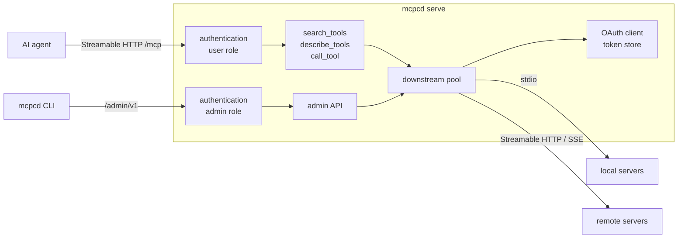

# mcp-compendium

[](https://scorecard.dev/viewer/?uri=github.com/steelshot/mcp-compendium)
[](https://www.bestpractices.dev/projects/16459)
[](https://github.com/steelshot/mcp-compendium/releases/latest)
[](LICENSE.md)

One daemon, `mcpcd`, that serves any number of MCP servers to AI agents as a single Streamable HTTP endpoint. Instead
of registering every downstream tool with the agent, it exposes three tools that let the agent find and call what it
needs:

| Tool             | Purpose                                                                                                            |
|------------------|--------------------------------------------------------------------------------------------------------------------|
| `search_tools`   | Ranked search over every server's tools by intent ("create a GitHub issue"). Its description lists the servers.    |
| `describe_tools` | Full descriptions and input schemas for chosen tools, or every tool of one server as one-line signatures.          |
| `call_tool`      | Call a tool. Arguments are validated first; a mismatch returns the schema so the agent fixes the call in one step. |

Agent clients cap how many tools they accept and pay for every tool definition in context. With a realistic catalogue
of 34 tools, the advertised tool list shrinks by 84 % (see [Measuring agent efficiency](CONTRIBUTING.md#measuring-agent-efficiency)).

It is a single static Go binary: no Node.js, npm or Python at runtime unless a stdio server you add needs them.

## How it works



- **Downstream pool.** Connects to every enabled server in parallel at startup and caches its tools. A failed server is
  retried in the background with exponential backoff, and a call to it reconnects on demand. Read-only and idempotent
  tools are retried once after a dropped connection; other tools are not, and the error says the call may have run.
- **Shared or isolated.** One connection serves every agent by default. `isolation: session` gives each agent session
  its own connection, and its own process for stdio servers, so stateful servers such as browsers never mix state.
- **Agent-facing errors** share one JSON shape: `code`, `message`, `hint` (the next action) and context such as
  `suggestions` for misspelt names, `retryAfterSeconds` or `mayHaveRun`.
- **Result shaping.** `structuredContent` that only duplicates a text block is dropped, and text beyond
  `maxResultBytes` (32 KiB by default, roughly 8k tokens) is truncated with a note telling the agent to narrow the
  request. Progress notifications and cancellation pass through.
- **Catalogue updates.** When a server connects, fails or signs in, the `search_tools` description changes and clients
  receive `notifications/tools/list_changed`.

## Quick start

```bash
cat > config.yaml <<'EOF'
servers:
  github:
    type: http
    url: https://api.githubcopilot.com/mcp/
    description: GitHub repositories, issues, pull requests and code search.
    headers:
      Authorization: Bearer ${env:GITHUB_TOKEN}
EOF

export GITHUB_TOKEN=...
mcpcd serve --config config.yaml
```

Point the agent at `http://127.0.0.1:8080/mcp`. For example, in GitHub Copilot CLI's `~/.copilot/mcp-config.json`:

```json
{
	"mcpServers": {
		"compendium": {
			"type": "http",
			"url": "http://127.0.0.1:8080/mcp"
		}
	}
}
```

Binaries for Linux, macOS and Windows are attached to each [release](https://github.com/steelshot/mcp-compendium/releases),
together with a cosign-signed checksum file; container images, a Helm chart and a Podman unit are described in
[Deployment](docs/DEPLOYMENT.md).

## Documentation

| Page                                                  | Covers                                                                                |
|-------------------------------------------------------|---------------------------------------------------------------------------------------|
| [Configuration](docs/CONFIGURATION.md)                | Flags and environment variables, the configuration file, placeholders                 |
| [Authentication](docs/AUTHENTICATION.md)              | Who may use the daemon: JWT, bearer and basic providers, and the `user`/`admin` roles |
| [Signing in to OAuth servers](docs/OAUTH.md)          | Sign-in links from agents, `mcpcd login`, and pre-registered OAuth clients            |
| [Command line](docs/CLI.md)                           | Every `mcpcd` command, the admin API, and the health endpoints                        |
| [Deployment](docs/DEPLOYMENT.md)                      | Binaries, container images, the Helm chart, and a Podman Quadlet unit                 |
| [Private certificate authorities](docs/PRIVATE-CA.md) | Trusting a corporate CA with Podman, Kubernetes or a derived image                    |
| [Releases](docs/RELEASES.md)                          | Versioning, and how releases are made                                                 |

## Contributing

Contributions are welcome; [CONTRIBUTING.md](CONTRIBUTING.md) covers development, the checks, and how pull requests
are titled and described. Report security issues privately as described in [SECURITY.md](SECURITY.md).

## Licence

[GNU Affero General Public License v3.0 only](LICENSE.md) (`AGPL-3.0-only`) © Džiugas Eiva
